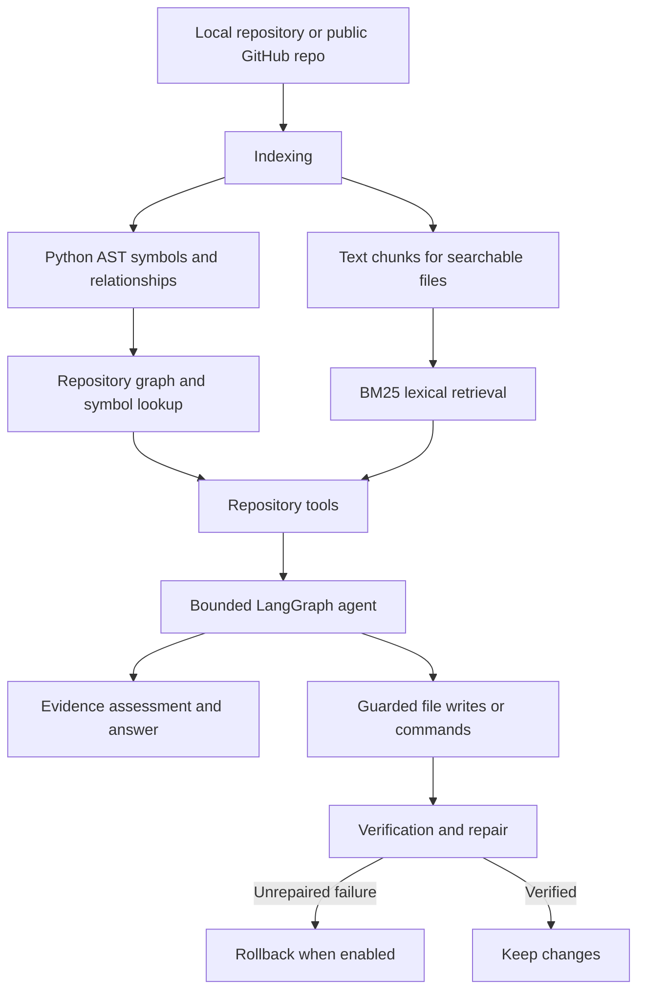

# Agentic Repository Intelligence (ARI)

**Understand a codebase, trace how it works, and make guarded changes using a repository-aware AI agent.**

ARI is a Python tool for exploring and modifying software repositories. It combines static Python analysis, a repository relationship graph, BM25-based lexical retrieval, source-backed evidence, and a bounded LangGraph agent. Use it from the terminal or through its Streamlit interface, with support for local folders and public GitHub repositories.

## Features

- **Repository-aware Q&A** — search source files and documentation, inspect implementations, and answer questions using repository evidence.
- **Code relationship analysis** — find symbols, callers, callees, importers, dependencies, and related files.
- **Source-backed answers** — ground responses in retrieved repository content and available file/line references.
- **Agentic investigation** — use a bounded, tool-driven workflow to plan work, inspect evidence, and answer questions.
- **Guarded code changes** — protected file writes and commands can use filesystem checkpoints, verification, repair attempts, and rollback.
- **Context budgeting** — cap estimated model-request size and compact older tool observations to help manage context usage.
- **Two interfaces** — use the terminal CLI or the Streamlit web UI.
- **Repository sources** — open a local folder, import a public GitHub repository, or select a cached repository in the UI.
- **Reusable indexes** — build and load saved repository indexes instead of rebuilding one for every CLI launch.

## How it works



## Requirements

- Python **3.10 or newer**
- A Gemini API key
- Git is recommended for importing public GitHub repositories; the importer has a ZIP-download fallback when Git is unavailable
- Internet access for model requests and public GitHub imports

## Installation

### 1. Get the project

```bash
git clone <your-repository-url>
cd <repository-directory>
```

Or download the project ZIP and extract it.

### 2. Create and activate a virtual environment

**Windows PowerShell**

```powershell
python -m venv .venv
.\.venv\Scripts\Activate.ps1
```

**Windows Command Prompt**

```bat
python -m venv .venv
.venv\Scripts\activate.bat
```

**Linux / macOS**

```bash
python3 -m venv .venv
source .venv/bin/activate
```

### 3. Install dependencies

```bash
python -m pip install --upgrade pip
python -m pip install -r requirements.txt
```

### 4. Configure the model

Copy `.env.example` to `.env` in the project root and add your API key.

**Windows PowerShell**

```powershell
Copy-Item .env.example .env
```

**Linux / macOS**

```bash
cp .env.example .env
```

Edit `.env`:

```dotenv
GEMINI_API_KEY=your_gemini_api_key_here
GEMINI_MODEL=gemini-3.5-flash-lite
GEMINI_TEMPERATURE=0
```

ARI accepts `GOOGLE_API_KEY` as an alternative key name. Legacy `GROQ_API_KEY`, `GROQ_MODEL`, and `GROQ_TEMPERATURE` variables are also accepted as fallbacks. Gemini settings take precedence.

**Never commit your real API key.** The project’s `.gitignore` is intended to keep `.env` out of Git.

## Usage

### Option A: Terminal CLI

#### Ask one question

```bash
python main.py --repo /path/to/repository --query "Where is RepoService.refresh defined?"
```

**Windows example**

```powershell
python main.py --repo "D:\projects\my-repo" --query "Who calls index_repository?"
```

#### Start an interactive session

```bash
python main.py --repo /path/to/repository
```

Ask questions at the `Query >` prompt. Available commands:

| Command | Purpose |
|---|---|
| `help` or `?` | Show usage and example questions |
| `status` | Show the active repository, index counts, and model configuration |
| `refresh` | Re-index the repository from disk |
| `exit` or `quit` | End the session |

#### CLI options

| Option | Purpose |
|---|---|
| `--repo PATH` | **Required.** Repository to inspect or modify |
| `--query "..."` | Run one query and exit; omit for interactive mode |
| `--index-dir PATH` | Load a previously saved index |
| `--max-steps N` | Override `MAX_AGENT_STEPS` for the run |
| `--plain` | Disable Rich terminal formatting |
| `--debug` | Show full tracebacks when errors occur |

Without `--index-dir`, ARI indexes the selected repository in memory. If you use a saved index, refresh it when repository contents change.

#### Build a saved index

```bash
python scripts/build_index.py /path/to/repository /path/to/ari-index
```

Then use it:

```bash
python main.py \
  --repo /path/to/repository \
  --index-dir /path/to/ari-index \
  --query "What are the main modules?"
```

### Option B: Streamlit web UI

Launch the interface from the project root:

```bash
streamlit run streamlit_app.py
```

The sidebar supports three repository sources:

- **Public GitHub URL** — enter a public repository URL or `owner/repo`, optionally specify a branch, and import/index it.
- **Local Folder** — enter a local repository path and optionally choose a saved-index directory. A missing index can be built automatically.
- **Cached Repos** — reopen a repository previously imported into the local cache.

The UI also supports folder browsing on Windows, an optional API-key override for the current UI session, repository status, and a chat input for questions about the active repository.

By default, imported repositories are stored under `data/repos/` and saved indexes under `data/indices/`. These directories are created as needed and are not included in the source ZIP.

## Configuration

Configuration is read from environment variables and `.env`. See `.env.example` and `src/agentrepo/agent/config.py` for the implementation defaults.

| Variable | Purpose | Default / behavior |
|---|---|---|
| `GEMINI_API_KEY` | Gemini API key | Required unless an accepted alternative key variable is set |
| `GOOGLE_API_KEY` | Alternative API key variable | Used if `GEMINI_API_KEY` is not set |
| `GEMINI_MODEL` | Model identifier | `gemini-3.5-flash-lite` |
| `GEMINI_TEMPERATURE` | Sampling temperature (`0`–`2`) | `0` |
| `MAX_AGENT_STEPS` | Maximum agent decision/tool-using turns | `8` |
| `MAX_PLAN_STEPS` | Maximum planned steps | `8` |
| `MAX_OBSERVATION_CHARS` | Maximum characters in a tool observation | `6000` |
| `MAX_REPAIR_ATTEMPTS` | Repair attempts after failed verification | `2` |
| `VERIFICATION_COMMAND` | Optional repository-specific verification command | Unset |
| `COMMAND_TIMEOUT_SECONDS` | Timeout for verification commands | `60` seconds |
| `ENABLE_CHECKPOINTS` | Enable checkpoints for protected mutations | `true` |
| `ROLLBACK_ON_REPAIR_LIMIT` | Roll back unrepaired changes when the repair limit is reached | `true` |
| `MODEL_CONTEXT_TOKEN_BUDGET` | Estimated token budget for one model request, including tool schemas | `25000` in the configuration code; can be overridden |

Boolean settings accept values such as `true`/`false`, `1`/`0`, `yes`/`no`, or `on`/`off`. Invalid values and out-of-range settings are rejected during configuration loading.

## Project structure

```text
.
├── main.py
├── streamlit_app.py
├── requirements.txt
├── .env.example
├── .gitignore
├── README.md
│
├── scripts/
│   └── build_index.py
├── data/
|   ├── repos/
|   └── indices/
|
└── src/
    └── agentrepo/
        ├── __init__.py
        ├── collector.py
        ├── filesystem.py
        ├── github_importer.py
        ├── graph.py
        ├── indexer.py
        ├── models.py
        ├── module_naming.py
        ├── persistence.py
        ├── resolver.py
        ├── retrieval.py
        ├── service.py
        ├── tools.py
        │
        └── agent/
            ├── __init__.py
            ├── app.py
            ├── config.py
            ├── context_budget.py
            ├── deep_agent.py
            ├── deep_state.py
            ├── evidence.py
            ├── execution.py
            ├── followups.py
            ├── intent.py
            ├── json_utils.py
            ├── model.py
            ├── observability.py
            ├── plan.py
            ├── prompts.py
            ├── safety.py
            ├── state.py
            ├── tools.py
            ├── utils.py
            └── verification.py
```

## Safety and limitations

ARI can make mistakes. Its safety mechanisms reduce some risks but do **not** make arbitrary code execution risk-free.

- Protected writes and commands can be checkpointed and rolled back when the configured policy calls for it.
- Checkpointing and rollback are controlled by `ENABLE_CHECKPOINTS` and `ROLLBACK_ON_REPAIR_LIMIT`; keep them enabled when using modification workflows.
- Command safety checks restrict which commands and paths can be used, but you should still review the proposed changes and executed commands.
- Verification is only as strong as the checks that actually run. A successful syntax check does not prove functional correctness.
- Python AST analysis cannot fully resolve dynamic dispatch, runtime-generated calls, or every framework convention.
- Non-Python files can be indexed as text, but do not receive the same AST-level analysis as Python files.
- Search and evidence can miss relevant code, particularly when repository state has changed since indexing. Re-index after significant changes.
- The GitHub importer is intended for **public** repositories; do not enter private repository credentials or secrets into prompts.
- Review changes before committing or deploying them. Keep backups or use Git for important work.

## Troubleshooting

**Missing API key**

- Confirm `.env` is in the project root and contains `GEMINI_API_KEY=...`.
- Alternatively, set `GOOGLE_API_KEY` in the environment.
- Restart the CLI or Streamlit app after changing environment variables.

**Repository changes are not reflected in answers**

- In CLI interactive mode, run `refresh`.
- If using `--index-dir`, rebuild the saved index with `scripts/build_index.py` and point ARI to the updated index.
- In the web UI, reload/re-index the repository as appropriate.

**Dependency or import errors**

```bash
python -m pip install -r requirements.txt
```

Ensure the virtual environment is activated and run commands from the project root.

**Model request or rate-limit errors**

- Reduce `MAX_AGENT_STEPS` or `MAX_PLAN_STEPS` to limit work per task.
- Lower `MODEL_CONTEXT_TOKEN_BUDGET` to leave more headroom for provider limits.
- Retry after a provider rate limit resets.


