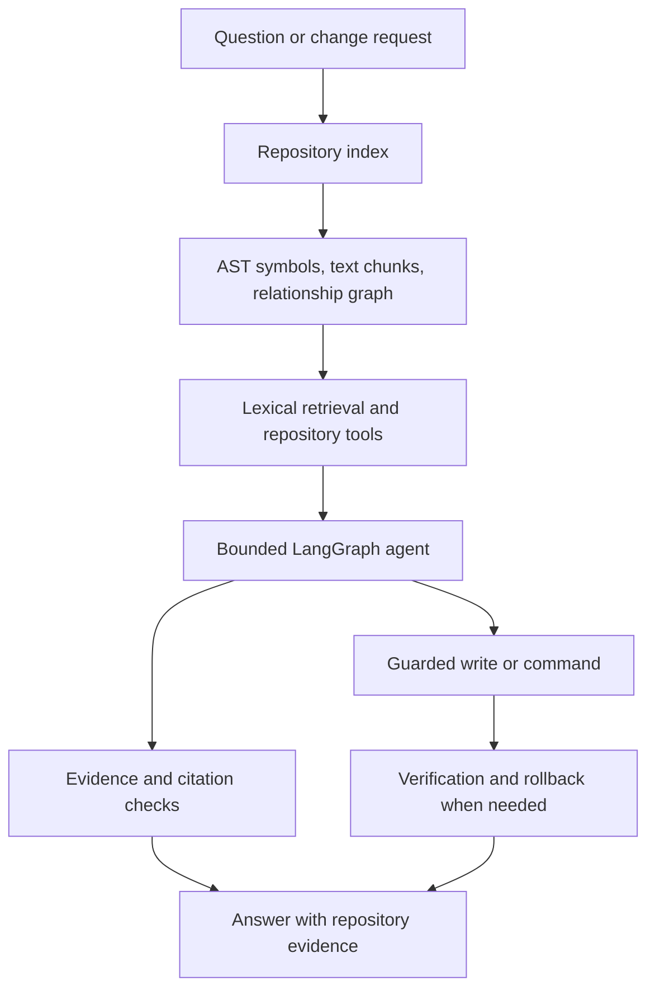

# Agentic Repository Intelligence (ARI)

**Ask questions about a codebase, trace how it works, and make guarded changes — from your terminal.**

ARI is a Python CLI assistant that investigates a local repository using indexed code structure and source-backed evidence. It combines Python AST analysis, a repository relationship graph, BM25+ search, and a bounded LangGraph agent. When changes are requested, ARI uses guarded write and verification workflows rather than treating every model-generated action as safe.


## Highlights

- **Repository-aware answers** — search code and documentation, locate symbols, and inspect implementations.
- **Code relationship analysis** — explore callers, callees, imports, dependencies, and inheritance relationships.
- **Evidence-grounded responses** — answers can reference repository paths and line ranges instead of relying only on model knowledge.
- **Guarded code changes** — scoped write access, command safety checks, checkpoints, verification, and rollback support.
- **Bounded agent workflow** — a single LangGraph agent coordinates investigation and tool use within configured limits.
- **Token-conscious context** — observations and prior context are compacted to help control model request size.
- **Terminal-first interface** — interactive sessions, one-shot queries, status, refresh, and plain-output mode.

## How it works



## Example questions

Run ARI against a repository and ask questions such as:

- `Where is RepoService.refresh defined?`
- `Who calls index_repository?`
- `What does collect_module call?`
- `Which modules import agentrepo.filesystem?`
- `Explain how a query flows through the agent`
- `What configuration variables does this project support?`
- `Add input validation to this function and verify the change`

ARI can also report when the indexed repository does not provide enough evidence. Treat that result as a useful boundary—not as proof that a feature does not exist anywhere.

## Requirements

- Python **3.10+**
- A Gemini API key
- Git is optional

## Setup

### 1. Clone the repository

```bash
git clone <your-repository-url>
cd <repository-directory>
```

### 2. Create a virtual environment

**Windows PowerShell**
```powershell
python -m venv .venv
.\.venv\Scripts\Activate.ps1
```

**Linux / macOS**
```bash
python3 -m venv .venv
source .venv/bin/activate
```

### 3. Install dependencies

```bash
python -m pip install --upgrade pip
python -m pip install -r requirements.txt
```

### 4. Configure Gemini

Create a `.env` file in the project root and add your Gemini API key. Use the variable names supported by your local `.env.example` and configuration module; never commit the real key.

```dotenv
GOOGLE_API_KEY=your_gemini_api_key_here
GEMINI_MODEL=gemini-3.5-flash-lite
```

If your checkout uses different environment-variable names, follow `.env.example` and `src/agentrepo/agent/config.py` as the source of truth.

## Usage

### Ask one question

```bash
python main.py --repo /path/to/repository --query "Where is RepoService.refresh defined?"
```

**Windows example**
```powershell
python main.py --repo "D:\projects\my-repo" --query "Who calls index_repository?"
```

### Start an interactive session

```bash
python main.py --repo /path/to/repository
```

At the `Query >` prompt, ask follow-up questions or use:

| Command | Action |
|---|---|
| `help` or `?` | Show help and example queries |
| `status` | Show the active repository and index/model status |
| `refresh` | Re-index after repository files change |
| `exit` or `quit` | End the session |

### Optional: save an index

Build an index outside the repository being analyzed:

```bash
python scripts/build_index.py /path/to/repository /path/to/ari-index
```

Then reuse it:

```bash
python main.py --repo /path/to/repository --index-dir /path/to/ari-index \
  --query "What are the main modules?"
```

Use `--plain` for plain terminal output and `--debug` for detailed error tracebacks.

## Safety and limitations

ARI includes safety mechanisms, but these do **not** make arbitrary code execution risk-free.

- Write and execution capabilities are gated by the agent's policy.
- Commands are checked against an allowlist/policy before execution.
- Filesystem checkpoints and rollback can help recover from failed changes.
- Verification is scoped and configurable; it is not a guarantee that a change is correct.
- Python AST analysis does not fully resolve dynamic dispatch, runtime-generated calls, or every framework convention.
- Non-Python files can be indexed as text, but do not receive the same AST-level analysis.
- Repository evidence can be incomplete. Review citations and verify important claims yourself.
- Do not point ARI at sensitive or untrusted repositories unless you understand the configured tool permissions and command policy.

## Configuration

Configuration defaults are defined in `.env.example` and `src/agentrepo/agent/config.py`. Common controls in this project include:

| Variable | Purpose |
|---|---|
| `MAX_AGENT_STEPS` | Limits the number of agent decision turns |
| `MAX_PLAN_STEPS` | Limits planned work |
| `MAX_OBSERVATION_CHARS` | Caps individual tool observations |
| `MAX_REPAIR_ATTEMPTS` | Limits repair attempts after failed verification |
| `COMMAND_TIMEOUT_SECONDS` | Sets command timeout |
| `ENABLE_CHECKPOINTS` | Enables filesystem checkpoints |
| `ROLLBACK_ON_REPAIR_LIMIT` | Controls rollback after exhausted repair attempts |
| `MODEL_CONTEXT_TOKEN_BUDGET` | Caps estimated model context per request |


## Project layout

```text
.
├── main.py
├── requirements.txt
├── .env.example
├── .gitignore
│
├── scripts/
│   └── build_index.py
│
├── data/
│   ├── symbols.json
│   ├── graph.json
│   ├── chunks.json
│   ├── airepo/
│   ├── rich_repo/
│   ├── rich_repo_idx/
│   ├── synth_out/
│   └── vqa/
│
└── src/
    └── agentrepo/
        ├── __init__.py
        ├── collector.py
        ├── filesystem.py
        ├── graph.py
        ├── indexer.py
        ├── models.py
        ├── module_naming.py
        ├── persistence.py
        ├── resolver.py
        ├── retrieval.py
        ├── service.py
        ├── tools.py
        │
        └── agent/
            ├── __init__.py
            ├── app.py
            ├── config.py
            ├── context_budget.py
            ├── deep_agent.py
            ├── deep_state.py
            ├── evidence.py
            ├── execution.py
            ├── followups.py
            ├── intent.py
            ├── json_utils.py
            ├── model.py
            ├── observability.py
            ├── plan.py
            ├── prompts.py
            ├── safety.py
            ├── state.py
            ├── tools.py
            ├── utils.py
            └── verification.py
```

