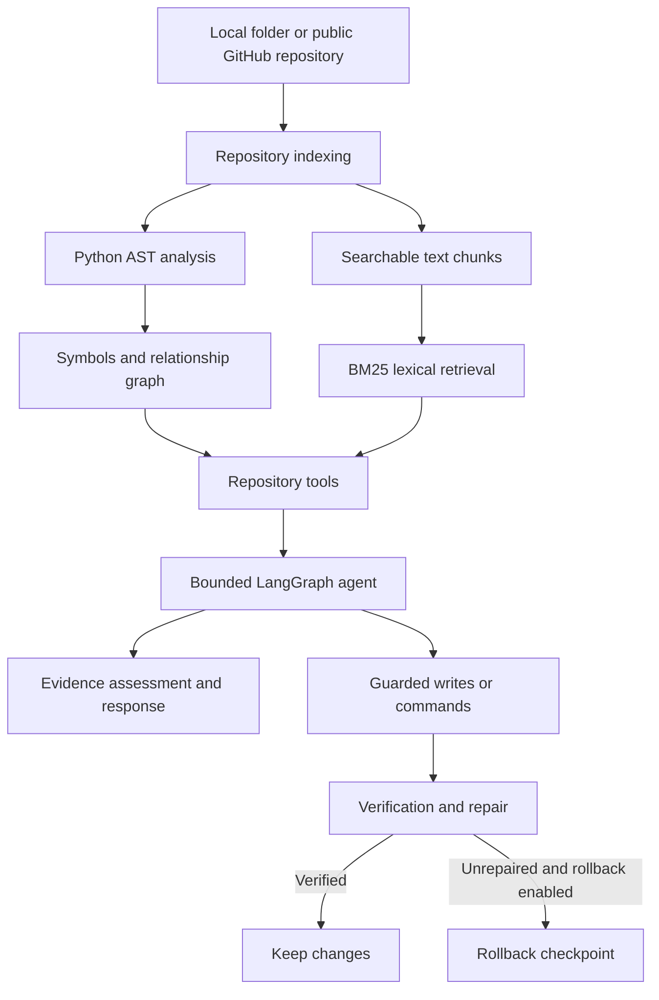

# Agentic Repository Intelligence (ARI)

**An agentic codebase assistant that indexes a repository, traces code relationships, answers questions with source evidence, and can perform guarded code changes.**

ARI combines static Python analysis, lexical retrieval, a repository relationship graph, and a bounded LangGraph agent in one workflow. Use it from the terminal or through a Streamlit interface to understand unfamiliar codebases, investigate dependencies, and explore implementation details without manually searching every file.

> **Project status:** Research / portfolio project. Review generated answers and proposed changes before relying on them in production.

## Highlights

- **Repository-aware Q&A** — ask natural-language questions about implementation, architecture, configuration, and behavior.
- **Symbol and dependency exploration** — inspect definitions, callers, callees, import relationships, and related modules.
- **Evidence-oriented responses** — retrieve relevant repository content and assess whether the evidence supports an answer.
- **Python-aware indexing** — use AST analysis to extract symbols and build relationships, alongside searchable text chunks for repository files.
- **Agentic investigation** — a bounded LangGraph workflow can plan work, call repository tools, inspect observations, and produce a final response.
- **Guarded code modification** — protected writes and commands can use checkpoints, verification, limited repair attempts, and rollback policies.
- **Context-budget controls** — cap estimated request size and compact older tool observations to help keep model requests within provider limits.
- **Two ways to work** — use the CLI for direct questions and interactive sessions, or the Streamlit UI for repository browsing and chat.
- **Local and public GitHub repositories** — open a local project or import a public repository from the UI.
- **Reusable indexes** — save an index and load it again without rebuilding it on every CLI launch.

## Architecture



### Request lifecycle

1. **Index** — collect repository files, extract Python symbols and relationships, and create searchable text chunks.
2. **Retrieve** — use lexical search and graph-backed tools to find relevant files, symbols, and source context.
3. **Investigate** — the agent follows a bounded tool-using workflow to gather evidence relevant to the request.
4. **Assess** — evaluate the available evidence before returning a response.
5. **Modify safely, when requested** — protected mutations can be checkpointed, verified, repaired within a configured limit, and rolled back if configured failure conditions are reached.

The AST analysis is strongest for Python. Other supported text files can be searchable without receiving equivalent semantic analysis.

## Tech stack

- **Python** — application, indexing, retrieval, and repository tooling
- **LangGraph / LangChain** — bounded agent workflow and model integration
- **Google Gemini API** — language model and tool-calling provider
- **BM25 (`rank-bm25`)** — lexical retrieval
- **Python `ast`** — static symbol and relationship extraction
- **Streamlit** — browser-based interface
- **Rich** — terminal presentation

## Getting started

### 1. Requirements

- Python **3.10+**
- A Google Gemini API key
- Internet access for Gemini requests and public GitHub imports
- Git recommended for importing public repositories; a ZIP-download fallback is available when Git is unavailable

### 2. Clone the repository

```bash
git clone <your-repository-url>
cd <repository-directory>
```

Or download and extract the project ZIP.

### 3. Create a virtual environment

**Windows PowerShell**

```powershell
python -m venv .venv
.\.venv\Scripts\Activate.ps1
```

**Windows Command Prompt**

```bat
python -m venv .venv
.\.venv\Scripts\activate.bat
```

**Linux / macOS**

```bash
python3 -m venv .venv
source .venv/bin/activate
```

### 4. Install dependencies

```bash
python -m pip install --upgrade pip
python -m pip install -r requirements.txt
```

### 5. Configure Gemini

Copy `.env.example` to `.env`.

**PowerShell**

```powershell
Copy-Item .env.example .env
```

**Linux / macOS**

```bash
cp .env.example .env
```

Add your API key to `.env`:

```dotenv
GEMINI_API_KEY=your_gemini_api_key
GEMINI_MODEL=gemini-3.5-flash-lite
GEMINI_TEMPERATURE=0
```

`GOOGLE_API_KEY` is also accepted as an alternative API-key variable.

**Keep your API key private. Never commit `.env` or paste secrets into repository questions.**

## Usage

ARI provides a command-line interface and a Streamlit interface.

### Option A — CLI

#### Ask a single question

```bash
python main.py --repo /path/to/your-repository --query "What are the main modules?"
```

**Windows example**

```powershell
python main.py --repo "D:\projects\my-repo" --query "Who calls index_repository?"
```

#### Start an interactive session

```bash
python main.py --repo /path/to/your-repository
```

You can ask multiple questions in the `Query >` prompt.

| Command | Action |
|---|---|
| `help` or `?` | Show commands and example questions |
| `status` | Show the active repository, index counts, and model configuration |
| `refresh` | Re-index the repository from disk |
| `exit` or `quit` | End the session |

#### CLI options

| Option | Description |
|---|---|
| `--repo PATH` | Repository to inspect or modify; required |
| `--query "..."` | Run one query and exit; omit for interactive mode |
| `--index-dir PATH` | Load a previously saved index |
| `--max-steps N` | Override `MAX_AGENT_STEPS` for the run |
| `--plain` | Disable Rich terminal formatting |
| `--debug` | Print full tracebacks for errors |

Without `--index-dir`, ARI indexes the selected repository in memory. Re-index after repository changes so answers reflect the latest source.

### Option B — Streamlit UI

Run the following from the project root:

```bash
streamlit run streamlit_app.py
```

The sidebar provides repository-loading options:

- **Public GitHub URL** — import a public repository using its URL or `owner/repo`; a branch can optionally be specified.
- **Local Folder** — load a repository from a path on the machine running Streamlit.
- **Cached Repositories** — reopen a repository imported earlier.

After loading a repository, use the chat workspace to ask questions and **Explore repository** to browse indexed files, preview source, and inspect incoming/outgoing symbol relationships from the repository graph.

By default, imported repositories are cached under `data/repos/` and saved indexes under `data/indices/`. These directories are generated at runtime.

### Option C — Build and reuse an index

Build a saved index:

```bash
python scripts/build_index.py /path/to/repository /path/to/ari-index
```

Load it for a query:

```bash
python main.py \
  --repo /path/to/repository \
  --index-dir /path/to/ari-index \
  --query "Where is the request handled?"
```

If the source repository changes, rebuild the saved index before querying it again.

## Example questions

Try asking ARI questions such as:

- `What are the main modules in this repository?`
- `Where is RepoService.refresh defined?`
- `Who calls index_repository?`
- `What does collect_module call?`
- `Which modules import agentrepo.filesystem?`
- `How is path_to_module implemented?`
- `Where is this configuration value read and used?`
- `Trace the flow from the entry point to the request handler.`

Questions that name concrete symbols, files, functions, or behaviors can make it easier to retrieve specific evidence.

## Configuration

Settings are loaded from environment variables and `.env`. See `.env.example` and `src/agentrepo/agent/config.py` for implementation defaults.

| Variable | Purpose | Default / behavior |
|---|---|---|
| `GEMINI_API_KEY` | Gemini API key | Required unless an accepted alternative key variable is set |
| `GOOGLE_API_KEY` | Alternative API key variable | Used when `GEMINI_API_KEY` is not set |
| `GEMINI_MODEL` | Model identifier | `gemini-3.5-flash-lite` |
| `GEMINI_TEMPERATURE` | Sampling temperature | `0` |
| `MAX_AGENT_STEPS` | Maximum agent decision/tool-using turns | `8` |
| `MAX_PLAN_STEPS` | Maximum planned steps | `8` |
| `MAX_OBSERVATION_CHARS` | Maximum characters in a tool observation | `6000` |
| `MAX_REPAIR_ATTEMPTS` | Repair attempts after failed verification | `2` |
| `VERIFICATION_COMMAND` | Optional repository-specific verification command | Unset |
| `COMMAND_TIMEOUT_SECONDS` | Timeout for verification commands | `60` seconds |
| `ENABLE_CHECKPOINTS` | Enable checkpoints for protected mutations | `true` |
| `ROLLBACK_ON_REPAIR_LIMIT` | Roll back unrepaired changes when the repair limit is reached | `true` |
| `MODEL_CONTEXT_TOKEN_BUDGET` | Estimated token budget per model request, including tool schemas | Configurable; see `config.py` |

Boolean settings accept common values such as `true`/`false`, `1`/`0`, `yes`/`no`, and `on`/`off`. Keep checkpointing and rollback enabled when experimenting with repository modifications.

## Project structure

```text
ari/
├── main.py                         # CLI entry point
├── streamlit_app.py                # Streamlit UI entry point
├── requirements.txt                # Python dependencies
├── .env.example                    # Configuration template
├── .gitignore
├── README.md
├── assets/
│   └── user_avatar.jpg
├── scripts/
│   └── build_index.py              # Build a reusable repository index
└── src/
    └── agentrepo/
        ├── collector.py            # Repository file collection
        ├── filesystem.py           # Filesystem operations and safeguards
        ├── github_importer.py      # Public GitHub repository import
        ├── graph.py                # Code relationship graph
        ├── indexer.py              # Index construction
        ├── models.py               # Core data models
        ├── module_naming.py        # Module path/name helpers
        ├── persistence.py          # Index persistence
        ├── resolver.py              # Symbol and relationship resolution
        ├── retrieval.py             # Lexical retrieval
        ├── service.py               # Repository service layer
        ├── tools.py                 # Repository-facing tools
        ├── ui_explorer.py           # Explorer support
        └── agent/
            ├── app.py               # Agent application assembly
            ├── config.py             # Runtime configuration
            ├── context_budget.py     # Model request budget and compaction
            ├── deep_agent.py         # Main agent workflow
            ├── deep_state.py         # Agent state
            ├── evidence.py           # Evidence assessment
            ├── execution.py          # Execution workflow
            ├── followups.py          # Follow-up handling
            ├── intent.py             # Request intent handling
            ├── json_utils.py         # JSON parsing helpers
            ├── model.py              # Gemini model setup
            ├── observability.py      # Concise run events
            ├── plan.py               # Bounded planning
            ├── prompts.py             # Agent prompts
            ├── safety.py              # Safety checks
            ├── state.py               # Shared state definitions
            ├── tools.py               # Agent tool definitions
            ├── utils.py               # Agent utilities
            └── verification.py        # Verification and repair
```

Runtime data such as imported repositories and saved indexes is generated under `data/` and is not part of the source tree.

## Safety, verification, and limitations

ARI includes safeguards, but they do **not** make arbitrary code execution or automated edits risk-free.

- Keep `ENABLE_CHECKPOINTS=true` and `ROLLBACK_ON_REPAIR_LIMIT=true` for modification workflows.
- Review changes and commands before relying on them; use Git or another backup mechanism for important repositories.
- Verification is only as strong as the configured checks. Passing a syntax check does not establish functional correctness.
- Rollback behavior depends on the mutation path, checkpoint coverage, and configured failure conditions. Do not treat it as a substitute for version control.
- Python AST analysis cannot completely resolve dynamic dispatch, runtime-generated calls, or every framework convention.
- Non-Python files may be indexed as text but do not receive the same AST-level analysis.
- Retrieval can miss relevant context, especially when the index is stale. Refresh or rebuild indexes after source changes.
- The GitHub importer is intended for public repositories. Do not provide private credentials or secrets to the agent.

## Troubleshooting

**ARI reports a missing API key**

- Check that `.env` exists in the project root and contains `GEMINI_API_KEY=...`.
- Alternatively, set `GOOGLE_API_KEY`.
- Restart the CLI or Streamlit process after changing environment variables.

**Answers do not reflect recent code changes**

- Use `refresh` in CLI interactive mode.
- If using a saved index, rebuild it with `scripts/build_index.py`.
- Reload or re-index the repository in the Streamlit UI.

**Dependency or import errors**

```bash
python -m pip install -r requirements.txt
```

Confirm that the virtual environment is active and commands are run from the project root.

**Model timeout, overload, or rate-limit errors**

- Retry after a short wait; provider availability and limits can vary.
- Reduce `MAX_AGENT_STEPS` or `MAX_PLAN_STEPS` to limit agent work.
- Lower `MODEL_CONTEXT_TOKEN_BUDGET` to leave more headroom for provider limits.


