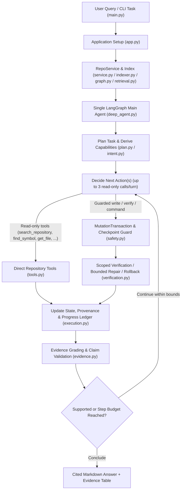

# Agentic Repository Intelligence (ARI)

**An agentic AI CLI assistant for understanding, investigating, and making guarded changes to software repositories.**

ARI answers questions about a local codebase using repository-grounded evidence rather than relying on unverified model assumptions. It combines deterministic AST indexing, static call/import graph resolution, BM25+ lexical retrieval, and a single bounded LangGraph agent with direct access to repository analysis, modification, and verification tools.

## What ARI Does (and Does Not Do)

**What it does:**
- Indexes local repositories (Python AST symbols, call/import/inheritance graphs, and text/documentation chunks).
- Routes all user queries through a single bounded LangGraph agent (`deep_agent.py`) that decides which repository tools (`search_repository`, `find_symbol`, `get_symbol`, `find_callers`, `find_callees`, `find_importers`, `get_dependencies`, `get_file`, `get_ast`, `find_files`) to invoke.
- Tracks evidence provenance and cites exact repository-relative file paths and line ranges (`path:start-end`), grading acceptance criteria and validating citations before presenting the final conclusion.
- Enforces capability gating (`READ` vs `WRITE` vs `EXECUTE`), command allowlists (`validate_command_safety`), and automatic filesystem checkpoints (`MutationTransaction`) with rollback on failed repairs or unauthorized command mutations.

**What it does not do:**
- It is a CLI demonstration and learning project, not a production-hardened autonomous software engineer or OS-level container sandbox.
- It does not provide a web UI or GUI.
- Its static AST call/import graph targets Python source files; non-Python text/config/markdown files are indexed as searchable text chunks without AST symbol extraction.
- Static call resolution cannot resolve dynamic dispatch (`getattr`, callbacks, runtime polymorphism) and reports unresolved receiver calls separately as `possible_callers` / `possible_callees`.

## Architecture



## Key Components

| Component | Responsibility |
|---|---|
| `src/agentrepo/indexer.py`, `collector.py`, `resolver.py` | Collects repository files, parses Python ASTs into `Symbol` and `Chunk` records, and resolves cross-file `CONTAINS`, `IMPORTS`, `INHERITS`, and `CALLS` edges. |
| `src/agentrepo/graph.py` | In-memory forward/backward adjacency graph (`CodeGraph`) over resolved and ambiguous code relationships. |
| `src/agentrepo/retrieval.py` | BM25+ lexical retriever (`LexicalRetriever`) with identifier splitting, morphological stemming, domain query expansion, and a built-in `BM25Plus` fallback if `rank-bm25` is absent. |
| `src/agentrepo/service.py` | Unified `RepoService` interface for lexical search (`search_repository`), symbol/graph queries, bounded file reads/writes, filesystem checkpoints, diffs, rollbacks, and sanitized command execution. |
| `src/agentrepo/agent/deep_agent.py` | Single-agent LangGraph orchestrator handling planning, tool batching, repeat/progress guards, evidence grading, claim validation, and deterministic fallback synthesis. |
| `src/agentrepo/agent/safety.py` & `verification.py` | Per-invocation `MutationTransaction`, command allowlist validation (`validate_command_safety`), pre-mutation checkpoints, `py_compile` scoped syntax verification, and automatic rollback. |
| `src/agentrepo/agent/evidence.py` | Tracks per-step provenance, verifies file/line-range citations, evaluates acceptance criteria, and synthesizes deterministic answers when model calls are rate-limited or empty. |
| `src/agentrepo/agent/context_budget.py` | Bounds model request token usage via structure-aware observation compaction and prevents oversized requests from being sent. |
| `src/agentrepo/agent/app.py` & `main.py` | CLI entry point, `RichTerminalUI` formatting, one-shot query mode, and interactive REPL (`help`, `status`, `refresh`, `exit`). |

## Supported Question Types

All queries enter the normal agent workflow (`requires GROQ_API_KEY`) and are answered using indexed repository tools:
1. **Symbol Definitions & Locations:**
   - *"Where is RepoService.refresh defined?"*
   - *"Where is CodeGraph.from_index located?"*
2. **Function & Class Implementations:**
   - *"How is path_to_module implemented?"*
   - *"Show the implementation of collect_module."*
3. **Callers, Callees, Importers & Dependencies:**
   - *"Who calls index_repository?"*
   - *"What does collect_module call?"*
   - *"Which modules import agentrepo.filesystem?"*
   - *"What are the dependencies of agentrepo.service?"*
4. **Documentation, Purpose, Module Inventory & Configuration:**
   - *"What is the purpose of this repository?"*
   - *"What are the main modules in this repository?"*
   - *"What environment variables are supported?"*
   - *"What accuracy scores were obtained?"*
5. **Missing / Unsupported Symbol & Topic Detection:**
   - *"Where is KubernetesClusterManager defined?"* -> Reports `UNSUPPORTED` honestly when repository searches find no matching symbol or evidence.
6. **Multi-Step Cross-File Investigation & Guarded Code Changes:**
   - *"Trace how a question flows through run_query, LazyDeepAgent, and build_deep_agent."*
   - *"Modify pkg/core.py to add input validation and run verification."*

## Free-Tier & Token-Budget Optimizations

ARI is tuned for free-tier LLM quotas and small per-request token budgets:
- **Single Bounded Retry (`max_retries=1`):** `ChatGroq` is configured with `max_retries=1` (`src/agentrepo/agent/model.py`) so rate-limit (`HTTP 429`) errors do not burn quota in retry loops.
- **Fatal Provider Error Short-Circuiting:** If `plan_task` or `decide` encounters an authentication (`401`/`403`), rate-limit (`429`), or connection failure, downstream nodes skip redundant LLM calls and synthesize deterministically from any gathered evidence.
- **Lookup Planning Bypass (`is_lookup_task`):** Simple read-only lookups that enter the agent graph skip the upfront `planning` LLM call.
- **Deterministic Exact-Source Follow-Up (`followups.py`):** When `find_files` or `find_symbol` returns a single unambiguous match, `prepare_followup` automatically schedules the corresponding `get_file` read without an extra decision LLM call.
- **Context Compaction (`MODEL_CONTEXT_TOKEN_BUDGET=6500`):** Tool observations and older turns are compacted at whole-line boundaries before every model call.

## Prerequisites & Installation

- **Python:** 3.10 or newer
- **Git:** Optional (used for read-only repository status metadata when available)
- **Groq API Key:** Required (`GROQ_API_KEY`) to execute queries through the agent.

### 1. Create and activate a virtual environment

**Linux / macOS:**
```bash
python3 -m venv .venv
source .venv/bin/activate
```

**Windows (PowerShell):**
```powershell
python -m venv .venv
.\.venv\Scripts\Activate.ps1
```

### 2. Install dependencies

```bash
python -m pip install -r requirements.txt
```

*(Note: `src/agentrepo/retrieval.py` and `src/agentrepo/agent/state.py` also include built-in fallbacks so core indexing and retrieval modules can import cleanly in minimal offline environments.)*

## Configuration

Copy `.env.example` to `.env` in the project root and supply your settings:

```dotenv
GROQ_API_KEY=your_groq_api_key_here
GROQ_MODEL=openai/gpt-oss-120b
GROQ_TEMPERATURE=0
MAX_AGENT_STEPS=8
MAX_PLAN_STEPS=8
MAX_OBSERVATION_CHARS=6000
MAX_REPAIR_ATTEMPTS=2
VERIFICATION_COMMAND=
COMMAND_TIMEOUT_SECONDS=60
ENABLE_CHECKPOINTS=true
ROLLBACK_ON_REPAIR_LIMIT=true
MODEL_CONTEXT_TOKEN_BUDGET=6500
```

| Setting | Default | Purpose |
|---|---|---|
| `GROQ_API_KEY` | *(none)* | Groq API key for running the LLM-backed repository agent. |
| `GROQ_MODEL` | `openai/gpt-oss-120b` | Tool-calling model identifier on Groq. |
| `GROQ_TEMPERATURE` | `0` | Sampling temperature (`0` to `2`). |
| `MAX_AGENT_STEPS` | `8` | Maximum tool-using LLM turns before forced wrap-up (`1`–`100`). |
| `MAX_PLAN_STEPS` | `8` | Maximum planned steps (`1`–`50`). |
| `MAX_OBSERVATION_CHARS` | `6000` | Maximum characters per tool observation (`1`–`100000`). |
| `MAX_REPAIR_ATTEMPTS` | `2` | Maximum repair attempts after a failed modification/verification (`1`–`10`). |
| `VERIFICATION_COMMAND` | `""` | Optional repository verification command (e.g. `pytest`). |
| `COMMAND_TIMEOUT_SECONDS` | `60` | Subprocess timeout in seconds (`1`–`300`). |
| `ENABLE_CHECKPOINTS` | `true` | Snapshot repository before writes/commands and roll back failed changes. |
| `ROLLBACK_ON_REPAIR_LIMIT` | `true` | Restore snapshot when unrepaired modifications end in failure. |
| `MODEL_CONTEXT_TOKEN_BUDGET` | `6500` | Estimated token budget per model request (`1000`–`1000000`). |

## Usage

### 1. Build a saved repository index (optional but recommended)

Save `symbols.json`, `graph.json`, and `chunks.json` to an external index directory (must be outside the target repository):

```bash
python scripts/build_index.py /path/to/repository /tmp/my_repo_index
```

### 2. Run a one-shot query

With a saved index:
```bash
python main.py --repo /path/to/repository --index-dir /tmp/my_repo_index --query "Where is RepoService.refresh defined?"
```

Or index in memory automatically (omit `--index-dir`):
```bash
python main.py --repo /path/to/repository --query "Who calls index_repository?"
```

Use `--plain` to disable Rich terminal panels/colors (useful for piping or logs) and `--debug` to print full tracebacks on errors.

### 3. Run an interactive session

```bash
python main.py --repo /path/to/repository
```

Inside the interactive prompt (`Query > `), you can ask natural-language questions or use built-in session commands:
- `help` or `?` — Display available commands and example questions.
- `status` — Show active repository path, indexed file/symbol/edge/chunk counts, and model configuration.
- `refresh` — Re-index the repository from disk after external edits.
- `exit` or `quit` — Exit cleanly.

## Troubleshooting

- **`Error: Configuration error: GROQ_API_KEY is not set...`**
  - Create a `.env` file from `.env.example` and set `GROQ_API_KEY`, or export it in your shell (`export GROQ_API_KEY=gsk_...`).
- **`Error: index output directory must be outside the repository being indexed`**
  - When running `scripts/build_index.py`, choose an output directory outside the target repository (e.g., `/tmp/ari_index` or `../ari_index`) so generated index JSON files do not pollute the target repository tree.
- **`HTTP 429` / Rate Limit or `HTTP 413` / Request Too Large**
  - Free-tier Groq accounts have strict tokens-per-minute (TPM) and tokens-per-day (TPD) limits. Lower `MODEL_CONTEXT_TOKEN_BUDGET` (e.g., `4500`), `MAX_OBSERVATION_CHARS` (e.g., `3500`), or `MAX_AGENT_STEPS` (e.g., `4`) in `.env`. When `429` occurs mid-run after evidence is gathered, ARI preserves the recorded evidence and synthesizes a deterministic fallback summary.
- **`Error: Repository path does not exist or is not a directory`**
  - Verify the path passed to `--repo` exists and is a directory.

## Project Structure

```text
ARI_Final_Agent_First_Clean/
├── main.py
├── requirements.txt
├── README.md
├── .env.example
├── .gitignore
├── docs/
│   └── FINAL_TECHNICAL_ANALYSIS.md
├── scripts/
│   └── build_index.py
├── tests/
│   ├── test_checkpoints_and_rollback.py
│   ├── test_command_policy_and_safety.py
│   ├── test_concurrency_and_isolation.py
│   ├── test_context_budget_and_single_agent.py
│   ├── test_lifecycle.py
│   ├── test_query_answering.py
│   └── test_source_scope_and_evidence.py
└── src/
    └── agentrepo/
        ├── __init__.py
        ├── collector.py
        ├── filesystem.py
        ├── graph.py
        ├── indexer.py
        ├── models.py
        ├── module_naming.py
        ├── persistence.py
        ├── resolver.py
        ├── retrieval.py
        ├── service.py
        ├── tools.py
        └── agent/
            ├── __init__.py
            ├── app.py
            ├── config.py
            ├── context_budget.py
            ├── deep_agent.py
            ├── deep_state.py
            ├── evidence.py
            ├── execution.py
            ├── followups.py
            ├── intent.py
            ├── json_utils.py
            ├── model.py
            ├── observability.py
            ├── plan.py
            ├── prompts.py
            ├── safety.py
            ├── state.py
            ├── tools.py
            ├── utils.py
            └── verification.py
```
