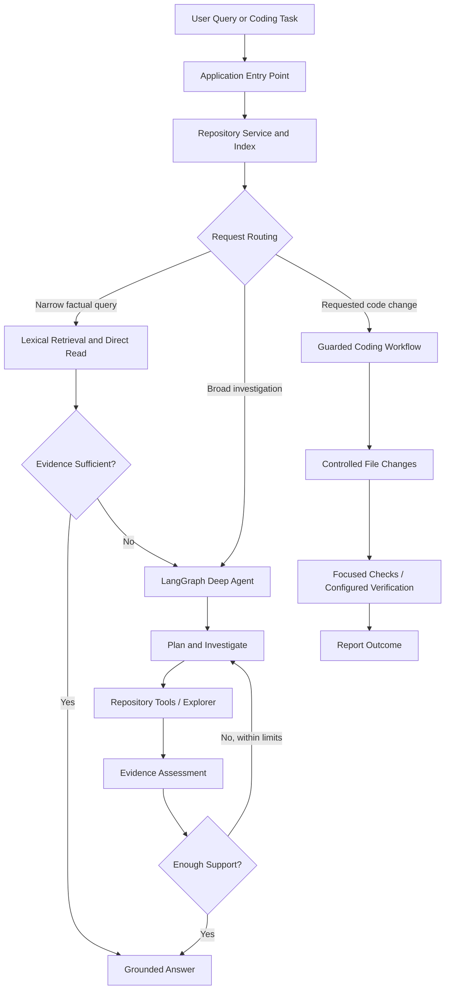

# Agentic Repository Intelligence (ARI)

**An agentic AI system for understanding, investigating, and making guarded changes to software repositories.**

ARI is designed to answer questions about a codebase using repository-grounded evidence rather than relying solely on an LLM's general knowledge. It combines repository indexing, symbol and relationship analysis, deterministic retrieval, and a bounded LangGraph agent that can investigate multi-file questions and handle requested code changes through a guarded workflow.

The goal is to make repository-level reasoning more structured, traceable, and reliable.

## Overview

Understanding an unfamiliar codebase often requires more than searching for a keyword. A useful answer may require locating a symbol, reading its implementation, tracing callers, following dependencies across files, and checking whether the available evidence actually supports a conclusion.

ARI approaches this as a repository investigation problem:

- **Retrieve first:** Use direct retrieval for narrow factual questions when source evidence is sufficient.
- **Investigate when needed:** Route broader questions through a bounded agentic workflow.
- **Follow the code:** Inspect files, symbols, callers, callees, import relationships, and dependencies.
- **Ground the answer:** Track evidence and source locations instead of treating model-generated assumptions as facts.
- **Guard code changes:** Separate read-only investigation from write and command-execution capabilities.

## Architecture



*Conceptual architecture based on the project's documented workflow; individual paths and runtime behavior should be verified against the implementation.*

## Key Components

| Component | Responsibility |
|---|---|
| Repository indexer | Collects repository files and extracts Python symbols and code chunks. |
| Repository graph | Represents code relationships, including calls and imports where they can be resolved. |
| Retrieval system | Locates relevant source material for focused questions. |
| Repository service | Provides a common interface for accessing indexed information and repository files. |
| LangGraph agent | Orchestrates bounded investigation for questions that need more than direct retrieval. |
| Explorer | Investigates the repository using specialized search and inspection tools. |
| Coder | Handles explicitly requested code modifications through guarded operations. |
| Debugger | Supports controlled command execution and verification workflows. |
| Evidence assessment | Evaluates whether collected source evidence supports a proposed answer. |
| Safety layer | Restricts repository access and separates user-authorized actions from model-generated tool arguments. |

## How a Query Is Handled

### 1. Repository indexing

ARI builds a representation of the target repository, including a file listing, Python symbols, code chunks, and relationships between code elements.

A saved index can be reused across queries instead of rebuilding the representation each time.

### 2. Retrieval before investigation

Narrow factual questions first use lexical retrieval and direct source reads. If the retrieved source provides sufficiently specific evidence, the system can answer without starting a full agentic investigation.

If the evidence is insufficient, the request can be escalated to the Deep Agent.

### 3. Agentic investigation

Broader questions may require inspecting multiple files, tracing dependencies, or revising an investigation plan.

The LangGraph workflow uses repository tools and specialized investigation capabilities within configured execution bounds. Retrieved content and file hints help guide the investigation, but hints alone are not treated as proof.

### 4. Evidence-based completion

The system maintains evidence with source paths, line ranges, result status, and provenance. An evidence assessment step checks whether the proposed answer is supported by the collected material.

The intention is to avoid presenting unsupported conclusions as verified facts.

### 5. Guarded code changes

When a user explicitly requests a repository change, ARI provides a separate coding workflow. Write and execute permissions are determined from the original request and the configured safeguards, rather than being granted solely because a model requests a tool.

The documented workflow includes filesystem checkpointing, focused syntax checks for changed Python files, and optional repository-wide verification.

## Repository Tools

The read-only tool set is designed to support:

- File discovery and content search
- Symbol and source-code lookup
- Focused file and symbol reads
- Caller and callee tracing
- Importer and dependency inspection
- AST-based structural inspection

Write operations are restricted to the coding workflow, while command execution is restricted to the debugging or explicit verification path. Repository paths and the amount of information returned to the model are constrained by the service and safety layers.

## Technology Stack

- **Python** — application and repository-analysis logic
- **LangGraph** — stateful agent orchestration
- **LangChain Core** — model and tool integration interfaces
- **Groq** — LLM provider integration through `langchain-groq`
- **AST and static analysis** — Python symbol and relationship extraction

## Getting Started

### Prerequisites

- Python installed and available on your `PATH`
- Git
- A Groq API key for workflows that invoke the LLM
- A local repository to analyze

### 1. Clone the repository

```bash
git clone https://github.com/Jayesh-2006/agentic-repository-intelligence.git
cd agentic-repository-intelligence
```

### 2. Create a virtual environment

Windows:

```powershell
python -m venv .venv
.\.venv\Scripts\Activate.ps1
```

If PowerShell blocks activation, you can use Command Prompt instead:

```cmd
.venv\Scripts\activate.bat
```

Linux/macOS:

```bash
python -m venv .venv
source .venv/bin/activate
```

### 3. Install dependencies

```bash
python -m pip install -r requirements.txt
```

### 4. Configure the model

Create a local `.env` file in the project root:

```dotenv
GROQ_API_KEY=your_groq_api_key
GROQ_MODEL=your_compatible_tool_calling_model
```

Replace the placeholders with your actual configuration. Keep `.env` out of version control; never commit API keys.

The API key is needed for LLM-backed agent workflows. Direct retrieval capabilities may be usable without invoking the model, depending on the request and application configuration.

### 5. Index a repository

Build and save an index for a Python repository:

```bash
python scripts/build_index.py /path/to/your/repository data/my_index
```

On Windows, for example:

```powershell
python scripts/build_index.py "D:\path\to\your\repository" "data\my_index"
```

The indexing script writes repository artifacts such as `symbols.json`, `graph.json`, and `chunks.json` to the selected output directory.

### 6. Ask a question

Run a one-shot query against a repository with a saved index:

```bash
python main.py --repo /path/to/your/repository --index-dir data/my_index --query "Where is RepoService.refresh defined?"
```

Or let ARI index the repository in memory:

```bash
python main.py --repo /path/to/your/repository --query "What are the main modules in this repository?"
```

For an interactive session:

```bash
python main.py --repo /path/to/your/repository --index-dir data/my_index
```

Enter questions at the prompt. Type `exit` or `quit` to finish.

On Windows, replace `/path/to/your/repository` with a valid local path, such as `D:\projects\my-repository`.

## Configuration

| Setting | Purpose |
|---|---|
| `GROQ_API_KEY` | Credentials for the Groq model provider. |
| `GROQ_MODEL` | Selects the compatible tool-calling model. |
| `VERIFICATION_COMMAND` | Optional repository-wide command used when verification is explicitly requested. |
| `MAX_AGENT_STEPS` | Configures the agent's execution bound, where supported by the application configuration. |

The CLI also supports `--max-steps` to override the configured agent step limit and `--debug` to display full error tracebacks.

See the application configuration and `.env.example` for the exact supported settings and defaults.

## Design Principles

**Retrieval before expensive reasoning.** Use a direct source lookup when it can adequately answer a narrow question.

**Bounded autonomy.** Limit investigation rather than allowing an agent to execute indefinitely.

**Evidence over confidence.** A plausible model-generated answer is not equivalent to a conclusion supported by source code.

**Least privilege.** Keep read-only investigation separate from file modification and command execution.

**Explicit verification.** Distinguish focused syntax checks from optional repository-wide validation; do not assume that an unspecified test command exists.

**Observable execution.** Emit progress information and available runtime measurements to help diagnose agent behavior and resource usage.

## Current Scope and Limitations

ARI is an evolving engineering project. Its architecture includes retrieval, agent orchestration, evidence assessment, and guarded code-change workflows, but these components should not be assumed to work correctly for every repository or query.

- Python is the primary target for symbol and relationship analysis.
- Unresolved or ambiguous call relationships may limit dependency tracing.
- Retrieval quality depends on the repository representation and the relevance of available source material.
- LLM-backed behavior depends on model capabilities, configuration, and API availability.
- Evidence assessment cannot guarantee that every answer is correct.
- Repository-wide verification depends on an explicitly configured command.
- Runtime performance, answer quality, and end-to-end reliability require further systematic evaluation.

This repository should be treated as an actively developed project rather than a production-ready autonomous software engineer.

## Project Structure

```text
agentic-repository-intelligence/
├── main.py
├── requirements.txt
├── README.md
├── scripts/
│   └── build_index.py
└── src/
    └── agentrepo/
        ├── agent/
        │   ├── app.py
        │   ├── deep_agent.py
        │   ├── deep_state.py
        │   ├── delegation.py
        │   ├── explorer.py
        │   ├── coder.py
        │   ├── debugger.py
        │   ├── evidence.py
        │   ├── safety.py
        │   ├── tools.py
        │   ├── prompts.py
        │   └── ...
        ├── indexer.py
        ├── retrieval.py
        ├── graph.py
        ├── service.py
        ├── filesystem.py
        ├── persistence.py
        ├── resolver.py
        └── ...
```

## Roadmap

Areas for continued engineering and evaluation include:

- Improve retrieval relevance and source-grounded answer quality.
- Evaluate evidence assessment against difficult and ambiguous questions.
- Expand repository-language support and relationship resolution.
- Measure investigation depth, token usage, latency, and tool-call efficiency.
- Strengthen regression coverage for retrieval, delegation, safety, and verification.
- Evaluate code modifications against representative repositories and failure scenarios.


